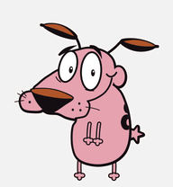
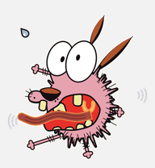
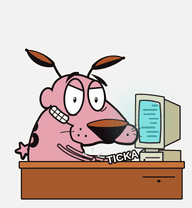
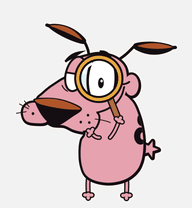
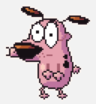
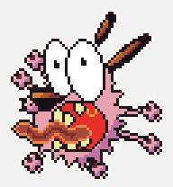
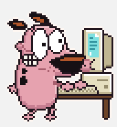
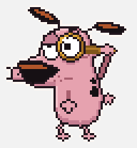

# petdex-pets

Animated desktop pets in the Codex pet format, usable in Orca, Codex and Petdex Desktop.
Drawn procedurally with Python (Pillow / pycairo) together with Claude Code.

## Catalog

| Pet | Folder | Petdex slug | Status |
|---|---|---|---|
| Courage the Cowardly Dog | `pets/courage/cartoon/` | `courage-the-cowardly-dog` | Approved (v4) |
| Courage the Cowardly Dog (Pixel) | `pets/courage/pixel/` | `courage-the-cowardly-dog-pixel` | Approved (v4.2); v5.2 edit submitted 2026-10-11, queued for admin review |

Track submissions at https://petdex.dev/u/acasaism.

## Preview

| | idle | failed | running (work) | review |
|---|---|---|---|---|
| Cartoon |  |  |  |  |
| Pixel |  |  |  |  |

Every state is in `pets/<character>/<variant>/preview/` (one GIF per state plus `sheet.png`).

## Workflow

Creating or updating a pet follows the `petdex-pet` skill (`.claude/skills/petdex-pet/`), which Claude Code loads
automatically in this repo; other agents start from `AGENTS.md`. In short: design from reference images, two review
passes (overview and zoomed detail), `tools/validate_pet.py` must pass, refresh previews, commit and tag.

## Layout

```
pets/<character>/<variant>/
├── pet.json          # published metadata (id = Petdex slug)
├── spritesheet.webp  # 1536x1872 lossless RGBA WebP, 8 columns x 9 rows of 192x208 cells
├── preview/         # GIF per state + sheet.png, rendered by tools/make_previews.py
└── make_pet.py       # generator
```

Rows, in order: idle (6), running-right (8), running-left (8), waving (4), jumping (5),
failed (8), waiting (6), running (6, the "working" state), review (6).

## Use a pet locally

Copy a variant folder to `~/.codex/pets/<id>/` (and `~/.petdex/pets/<id>/` for Petdex Desktop),
where `<id>` is the `id` in its `pet.json`. In Orca: Choose pet → Import .codex-pet bundle → pick the folder.

## Regenerate

```sh
python3 -I pets/courage/pixel/make_pet.py     # writes pets/courage/pixel/build/
python3 -I pets/courage/cartoon/make_pet.py   # writes pets/courage/cartoon/out/
```

Generators write a local build (with their original local ids `agallas` / `agallas-cartoon`) plus QA images,
all git-ignored. Copy the new `spritesheet.webp` over the committed one to update a pet.
Reference art is not committed: keep it in `pets/<character>/refs/` (git-ignored, with `SOURCES.txt`) and compare with `tools/review_sheets.py --refs pets/<character>/refs`. The Courage generators' own comparison images expect file names from their original session and are skipped when those files are missing.

After committing a new spritesheet, refresh its previews:

```sh
python3 -I tools/make_previews.py pets/<character>/<variant>
```

## Publish and update on Petdex

```sh
npx petdex login
npx petdex submit pets/<character>/<variant> --license cc-by-nc   # one folder per call
npx petdex edit <slug> --sprite pets/<character>/<variant>/spritesheet.webp
```

Submitting a parent folder with several pets asks for an interactive confirmation.

`petdex edit` only works once a pet is approved; a pending one returns `pet_not_editable`.
A pending submission can be withdrawn from the web profile ("Retirar envío") and resubmitted.

## Versions

Tags are `<character>-<variant>-vN`, e.g. `courage-cartoon-v4`, `courage-pixel-v3`.
Tags created before the move to `pets/` use the old layout (`agallas/`, `agallas-cartoon/`, `submission/`).

## Rights

Fan art. Courage the Cowardly Dog is a Cartoon Network character; no rights to the character are claimed.
The artwork is published on Petdex under CC BY-NC.
