# petdex-pets

Animated desktop pets in the Codex pet format, usable in Orca, Codex and Petdex Desktop.
Drawn procedurally with Python (Pillow / pycairo) together with Claude Code.

## Catalog

| Pet | Folder | Petdex slug | Status |
|---|---|---|---|
| Courage the Cowardly Dog | `pets/courage/cartoon/` | `courage-the-cowardly-dog` | Approved (v4) |
| Courage the Cowardly Dog (Pixel) | `pets/courage/pixel/` | `courage-the-cowardly-dog-pixel` | Approved (v4.2); v6 edit submitted 2026-10-11, queued for admin review |
| Chowder | `pets/chowder/cartoon/` | `chowder` | v1 submitted 2026-11-07, held for review |
| Chowder (Pixel) | `pets/chowder/pixel/` | `chowder-pixel` | v1 submitted 2026-11-07, held for review |

Track submissions at https://petdex.dev/u/acasaism.

## Preview

| | idle | failed | running (work) | review |
|---|---|---|---|---|
| Courage (cartoon) | 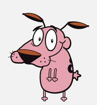 | 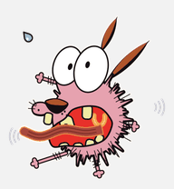 | 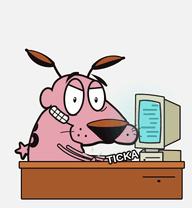 | 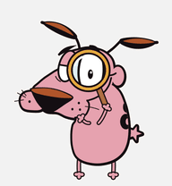 |
| Courage (pixel) | 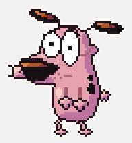 | 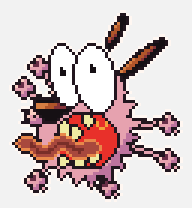 |  | 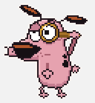 |
| Chowder (cartoon) | 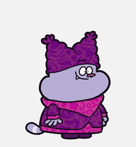 | 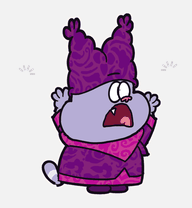 | 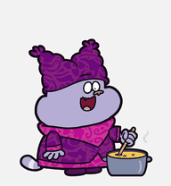 | 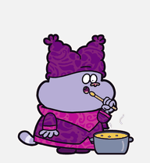 |
| Chowder (pixel) |  | 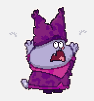 | 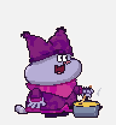 | 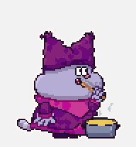 |

Every state is in `pets/<character>/<variant>/preview/` (one GIF per state plus `sheet.png`).

## Use a pet locally

Copy a variant folder to `~/.codex/pets/<id>/` (and `~/.petdex/pets/<id>/` for Petdex Desktop),
where `<id>` is the `id` in its `pet.json`. In Orca: Choose pet → Import .codex-pet bundle → pick the folder.

## Contributing

Issues and pull requests are welcome: fixes to a sprite, new pets or variants, tooling improvements.
See [CONTRIBUTING.md](CONTRIBUTING.md).

## Rights

Fan art. Courage the Cowardly Dog and Chowder are Cartoon Network characters; no rights to the characters are claimed.
The artwork is published on Petdex under CC BY-NC. The code (generators and tools) is MIT, see `LICENSE`.
